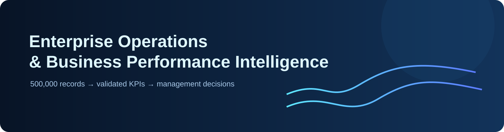
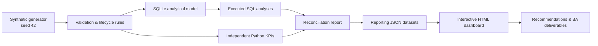

<div align="center">


# Enterprise Operations & Business Performance Intelligence

### From 500,000 synthetic operational records to validated KPIs, root-cause analysis and management decisions.

[](scripts/run_pipeline.py) [](data/processed/sql_results.json) [](dashboards/executive_dashboard.html) [](https://github.com/anujs-maker/enterprise-operations-intelligence/actions/workflows/ci.yml)

**Synthetic portfolio project · independently developed · HTML dashboard, not native Power BI**

[Overview](#overview) · [Dashboard](#dashboard) · [Architecture](#architecture) · [Insights](#verified-insights) · [SQL](#technical-depth) · [BA deliverables](#technology-business-analysis) · [Quick start](#quick-start)
</div>

## Overview

This project simulates a multinational business-services organisation operating across five Indian cities. Leaders need dependable visibility into service volume, SLA risk, turnaround, backlog, cost and quality before deciding where to add capacity or redesign a process.

The implementation connects deterministic data generation, validation, SQLite analysis, independent KPI reconciliation and a browser dashboard—relevant to Data Analyst, BI Analyst, Reporting Analyst, Technology BA and Analytics Consulting interviews.

## Executive snapshot

| Verified metric | Result |
|---|---:|
| Synthetic requests | **500,000** |
| Completed requests | **497,839** |
| SLA compliance | **74.60%** |
| Average turnaround | **40.47 hours** |
| Open backlog | **2,161** |
| Overdue backlog | **488** |
| Average quality score | **91.24 / 100** |

These are reproducible synthetic observations as of `2026-07-01`, not corporate performance claims.

## Dashboard

Open [`dashboards/executive_dashboard.html`](dashboards/executive_dashboard.html) locally after running the pipeline. It provides city filtering with weighted KPI recalculation, SLA charting, backlog/overdue cards, cost-per-completed-case and quality cards, plus a scoped Gurugram Payments Operations scenario control. GitHub renders the source but does not execute its JavaScript. A native PBIX is not provided.

## Architecture



## Verified insights

1. **SLA risk is concentrated in Gurugram:** 63.42% compliance versus approximately 77% in the other cities.
2. **Gurugram has the highest cost per completed case:** ₹3,914.22, versus ₹3,461.97 in Pune.
3. **Backlog is measurable and actionable:** 2,161 open requests include 488 already overdue against SLA targets.
4. **The scenario is scope-controlled:** June 2026 Gurugram Payments Operations includes 4,011 opened requests and 3,794 completions.
5. **Only avoided overtime is monetised:** the scoped 15% improvement models ₹2.4648M avoided overtime less ₹250,000 implementation cost; this is not realised savings.

<details><summary><b>Scenario assumptions</b></summary>

1,600 assigned FTEs, 160 productive hours/FTE/month, 82% utilisation, ₹130 overtime rate and ₹250,000 implementation cost. Capacity released is reported separately from cash savings. See [`docs/scenario_assumptions.md`](docs/scenario_assumptions.md).
</details>

## Technical depth

- [`scripts/run_pipeline.py`](scripts/run_pipeline.py) generates data, creates SQLite, executes SQL and fails on reconciliation mismatches.
- [`sql/kpi_analysis.sql`](sql/kpi_analysis.sql) contains SLA, backlog ageing, complexity, productivity and window-function trend analyses.
- [`data/processed/sql_results.json`](data/processed/sql_results.json) contains executed results.
- [`data/processed/reconciliation_report.json`](data/processed/reconciliation_report.json) records SQL value, independent Python value, difference, tolerance and PASS/FAIL.

<details><summary><b>Example analytical SQL</b></summary>

```sql
WITH ranked AS (
  SELECT city, substr(opened_at, 1, 7) AS month, COUNT(*) AS volume,
         LAG(COUNT(*)) OVER (PARTITION BY city ORDER BY substr(opened_at, 1, 7)) AS prior_volume
  FROM requests GROUP BY city, substr(opened_at, 1, 7)
)
SELECT city, month, volume, prior_volume FROM ranked;
```
</details>

## Technology Business Analysis

- [`BRD.md`](docs/business_requirements/BRD.md) — problem, stakeholders, requirements and acceptance;
- [`KPI_dictionary.md`](docs/data_dictionary/KPI_dictionary.md) — definitions, grain and formulas;
- [`data_model.md`](docs/data_dictionary/data_model.md) — relationships and leakage controls;
- [`UAT_cases.md`](docs/uat/UAT_cases.md) — acceptance scenarios;
- [`traceability.md`](docs/traceability.md) — requirement-to-evidence mapping;
- [`findings.md`](reports/findings/findings.md) — quantified observations and recommendations.

Stakeholders, approvals and UAT ownership are explicitly simulated.

## Quick start

```bash
python3 scripts/run_pipeline.py
python3 -m unittest discover -s tests -v
open dashboards/executive_dashboard.html
```

The core workflow uses the Python standard library. Optional pandas/DuckDB dependencies are in [`requirements.txt`](requirements.txt). The private `INTERVIEW_PLAYBOOK.md` is excluded from the public repository.

## Testing and quality

The suite has **11 passing tests** covering reproducibility, referential integrity, lifecycle logic, SLA boundaries, backlog ageing, scenario assumptions, SQL/Python reconciliation, corrupted-side detection, zero-volume handling and dashboard data contracts. GitHub Actions runs the pipeline and tests: [`.github/workflows/ci.yml`](.github/workflows/ci.yml).

## Limitations and disclosure

- Data is deterministic synthetic data generated with seed `42`.
- Findings describe the simulation and are not client results.
- Financial outputs are assumption-based opportunities, not realised savings.
- The dashboard is HTML/JavaScript, not native Power BI.
- No PBIX is included because a genuine PBIX could not be authored and verified here.
- GitHub does not execute dashboard JavaScript directly from the README; use the local dashboard file.

## License

MIT. Synthetic data is original to this project.
